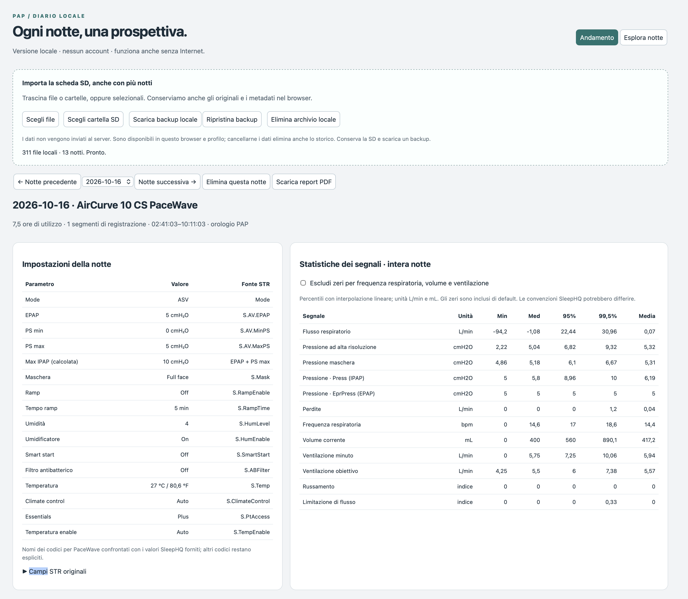
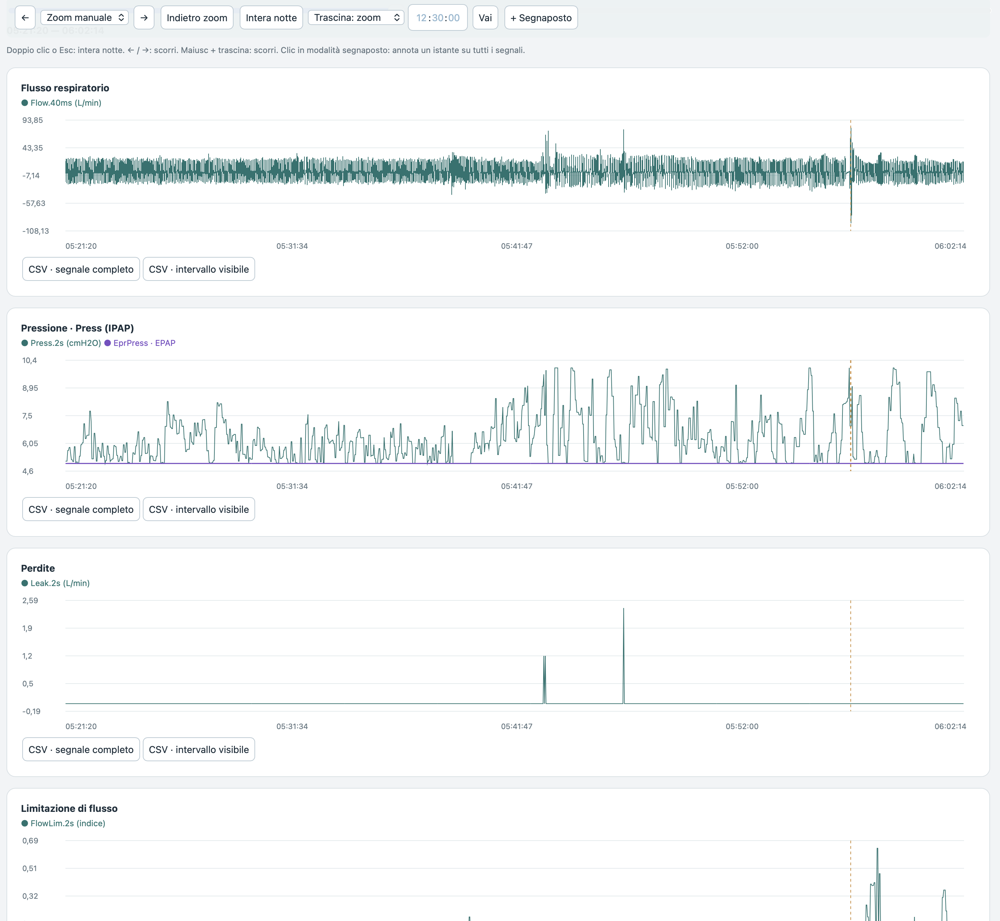

# BreathPAPGuardian

A local PAP data explorer with interactive charts, a night journal and exports. Built around **ResMed AirCurve 10 CS PaceWave** recordings.

## Features

- Import EDF files or an SD-card folder and browse multiple nights.
- Explore synchronized charts, pressure overlays, settings and statistics.
- Add markers with notes, images and videos.
- Export CSV signals and PDF reports.
- Back up and restore your archive, including attachments.
- Automatically calculate Glasgow Index and nine component fractions on import.
- Compare colored, selectable metrics in a multi-night bar chart, including mean GI.
- View five summary measures: annotated AHI, flow limitation, use and mean GI
  across the latest seven available nights, plus total nights in the archive.
- Switch between the classic GI timeline and component curves; reorder visible
  signals by drag and drop. PDF reports preserve the selected chart and order.
- Inspect the two key GI statistics alongside signal statistics; expand component
  fractions if needed. The night list starts collapsed.

See [Glasgow Index: method and usage](docs/glasgow-index.md).
An offline [interactive preview](docs/glasgow-preview.html) uses synthetic data only;
download and open the HTML file in your browser. GI remains experimental flow-shape
analysis, not a diagnostic index or RDI.

## Dashboard preview

Screenshots from real-world use of the original Italian interface. The current application is in English.

**Night settings and signal statistics**



**Synchronized signal charts**



## Quick start

Download or clone this repository. From its folder, run:

```sh
python3 server.py
```

Open **[http://127.0.0.1:8765](http://127.0.0.1:8765)**. Keep the terminal open; press **Ctrl+C** to stop.

Requires Python 3 and a modern browser. No pip/npm dependencies or build step.

**macOS launchers:**

```sh
bash Avvia-PAP.command
# Or, with Docker Desktop running:
bash Avvia-con-Docker.command
```

**Docker on other platforms:**

```sh
docker build -t pap-locale:1 .
docker run --rm --init -it --read-only --cap-drop ALL \
  --security-opt no-new-privileges=true \
  -p 127.0.0.1:8765:8765 pap-locale:1
```

The initial Docker build needs Internet access; subsequent use works offline.

## Usage

Choose **Choose SD folder** or **Choose files**, then select a night. Drag on charts to zoom; **Shift + drag** pans, and **Esc** resets the view. Use **+ Marker** for notes and **Download local backup** to save your archive.

## Privacy and storage

Processing happens in your browser, with no accounts, analytics or external application services. Data stays in **IndexedDB**, not in the program folder or Docker container.

Always use the same browser, profile and URL: `localhost` and `127.0.0.1` have separate archives. Clearing browser data can erase your history.

**Download backups regularly.** Backup JSON includes recordings and attachments and is not encrypted by the app. Keep it private and out of GitHub. Transfer between devices uses manual backup/restore.

### Portable archive with Proton Drive (preview)

This is an opt-in alternative to browser storage. Each Mac keeps a local SQLite
working archive; **Publish to shared folder** creates a versioned copy of the
database and content-addressed EDF/media attachments in a Proton Drive folder.
The shared folder never contains a live SQLite database. Only one computer
should work on the archive at a time.

1. In Finder, create a private folder in Proton Drive for this archive and make
   it **Available offline**. Wait for the initial sync to complete.
2. From the repository folder, start the app on the first Mac (adjust the shared
   path to the actual Finder folder):

   ```sh
   python3 server.py --data-dir "$HOME/Library/Application Support/BreathPAPGuardian/portable" --shared-dir "$HOME/Proton Drive/BreathPAPGuardian"
   ```

3. Open `http://127.0.0.1:8765` in your usual browser. If you have an existing
   browser archive at this exact URL, use **Copy browser archive here** once.
   The browser source is preserved. Otherwise import your SD card. Click
   **Publish to shared folder** after every session, then wait for Proton Drive
   to finish uploading all files before closing the first Mac.
4. On the second Mac, install Proton Drive, make the same shared folder
   **Available offline**, wait for download, and start the app with its own
   local `--data-dir` and that Mac's actual `--shared-dir` path. Click
   **Open shared version** before editing. Publish changes and wait for sync
   before returning to the first Mac; click **Open shared version** there.

The app checks the SHA-256 digest of the database and every attachment before
opening a shared version. If files have not finished syncing, wait and retry.
It blocks edits when it can see a newer shared version, and refuses to discard
unpublished local changes. This does not provide simultaneous multi-computer
editing or detect another computer's uploads before Proton Drive delivers them.
Keep backups: published versions are retained, and opening a newer version
keeps `previous.sqlite` in the local working folder. The local working folder
and browser backups contain unencrypted health data; protect your Mac account
and disk. Never put either working folder or patient data in the Git repository.

To return to the original IndexedDB mode, launch `python3 server.py` without
the two archive options. These are separate archives.

## Limitations

- Intended for data exploration, **not diagnosis**.
- One PAP device per archive; compatibility with other devices is not guaranteed.
- Nights run noon to noon using the device clock, without time zone conversion.
- Calculated episodes and statistics may differ from SleepHQ.
- Attachments are limited to 30 MB each; PDFs list media without embedding it.
- Portable mode requires the local Python server; the standalone HTML preview
  and default launchers continue to use browser IndexedDB.

## Support and contributions

Report bugs or propose changes through [GitHub Issues](https://github.com/vincenzojrs/BreathPAPGuardian/issues). Include reproduction steps and your environment; use synthetic examples rather than private health data.

See [LEGGIMI.txt](LEGGIMI.txt) for additional startup, transfer and update notes.

## License

Licensed under **GNU GPL version 3 or, at your option, any later version**
([LICENSE](LICENSE)). Distributed without warranty.

Glasgow calculations adapt DaveSkvn's code through VibeCoder75321's multi-night
analyzer. Copyright notices, pinned source revision and modifications are in
[THIRD_PARTY_NOTICES.md](THIRD_PARTY_NOTICES.md).

The app reads EDF directly in JavaScript and does not bundle or invoke
edf2ascii or EDFlib.

